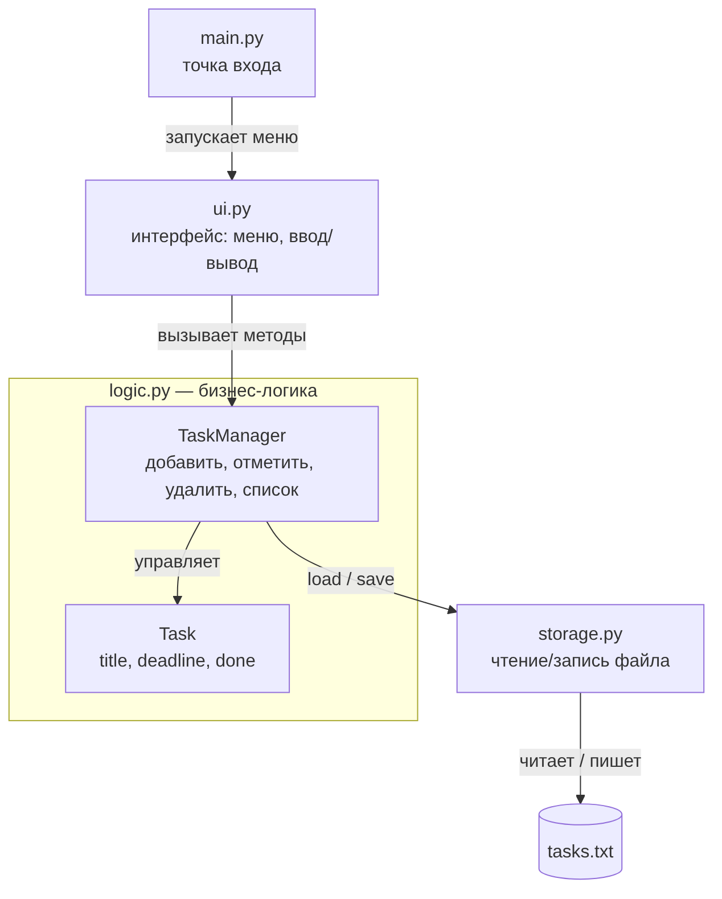

# Архитектура: Список дел (To-Do List)

## Функциональные требования

1. Добавить дело (название, срок выполнения).
2. Вывести список всех дел с отметкой статуса (выполнено / не выполнено).
3. Отметить дело выполненным.
4. Удалить дело.
5. Сохранять список дел между запусками программы.

## Компоненты

- main.py — точка входа, запускает главное меню.
- ui.py — слой представления: меню, ввод данных и вывод списка дел.
- logic.py — бизнес-логика: класс Task (дело) и класс TaskManager (добавление, отметка выполнения, удаление, список).
- storage.py — хранение: чтение и запись списка дел в файл tasks.txt.

## Связи

- main.py запускает ui.py.
- ui.py обращается к logic.py (вызывает методы TaskManager).
- logic.py читает и сохраняет данные через storage.py.
- Зависимость идёт только вниз: main → ui → logic → storage.
- Обратные вызовы запрещены: storage не знает о logic и ui, logic не знает об ui.

## Диаграмма

